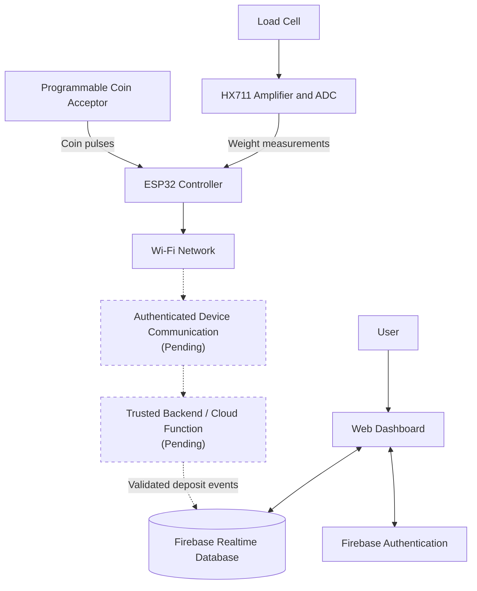
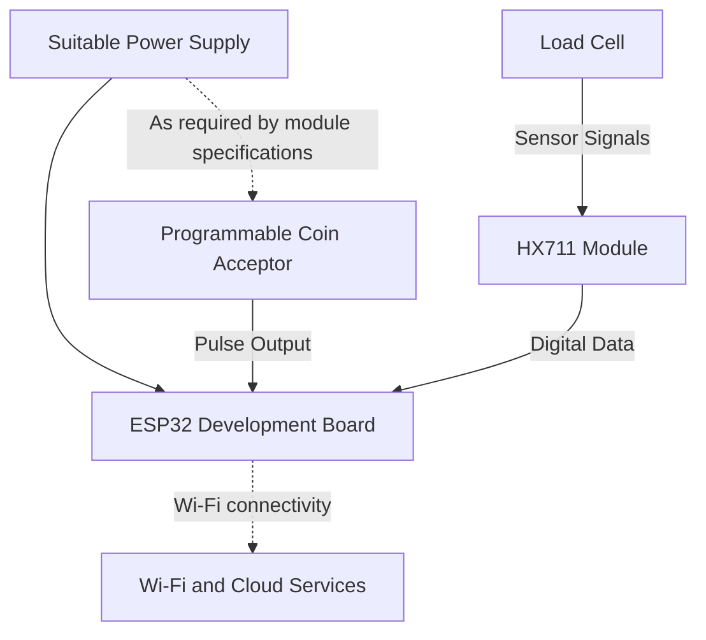
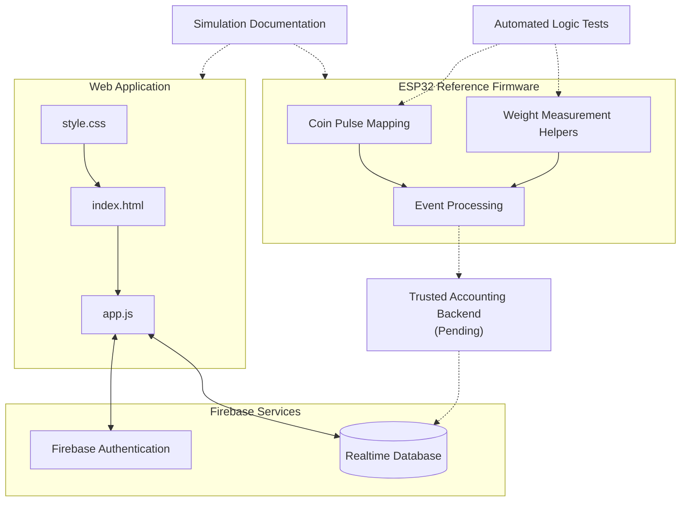
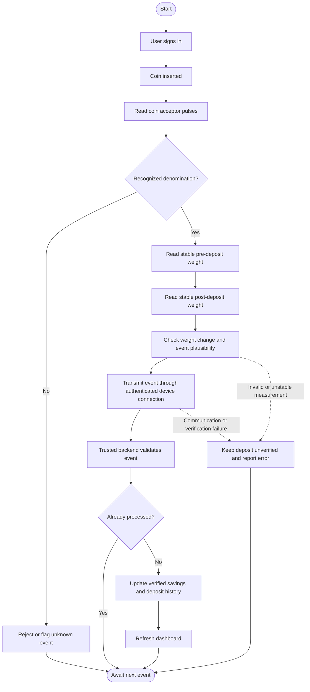
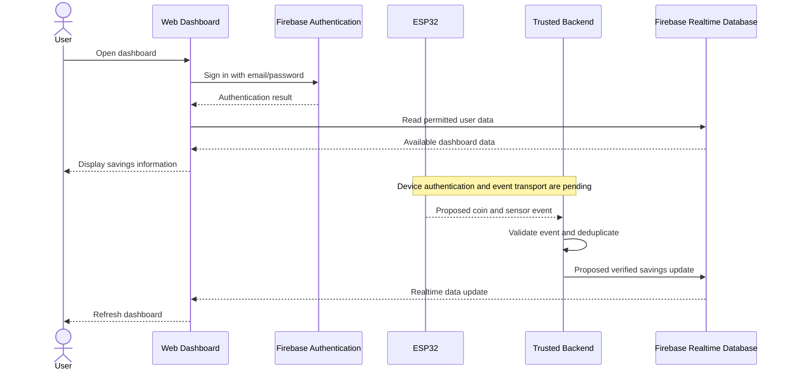

# Smart Digital Piggy Bank

**An IoT-based savings monitoring system using ESP32, a programmable coin acceptor, HX711 load-cell sensing, Firebase, and a web dashboard.**

**Developed by:** ANBU SELVAN  
**GitHub:** [ANBUSELVAN-PR](https://github.com/ANBUSELVAN-PR)


---

## 1. Project Overview

The Smart Digital Piggy Bank is designed to combine coin identification, weight measurement, cloud data storage, and a web dashboard to help users monitor their savings.

The proposed system uses a programmable coin acceptor to identify coin denominations and a load cell with an HX711 module to measure the weight of the collected coins. An ESP32 processes sensor inputs and is intended to communicate with cloud services over Wi-Fi.

The web dashboard uses Firebase Authentication and Firebase Realtime Database to provide a user interface for savings information and deposit history.

**Important:** Weight measurements are used for physical monitoring and plausibility checks. Weight alone must never determine a coin's monetary value.

### Main Objectives

- Identify configured coin denominations.
- Measure the accumulated weight of coins.
- Monitor savings and target progress.
- Display deposit history and sensor status.
- Provide authenticated access to the dashboard.
- Support isolated simulation for development.
- Establish a foundation for future IoT hardware integration.

---

## 2. System Block Diagram

The following diagram illustrates the intended end-to-end system architecture. Components marked as pending require further implementation.



### Diagram Explanation

1. The coin acceptor generates pulse signals when a coin is inserted.
2. The ESP32 is intended to map recognized pulse patterns to configured denominations.
3. The load cell and HX711 measure the physical weight of the coins.
4. The ESP32 is intended to transmit sensor readings and coin events over Wi-Fi.
5. A trusted backend must authenticate device events, prevent duplicate processing, and update verified savings.
6. Firebase Realtime Database stores authorized user data.
7. The authenticated dashboard displays available savings information.

The ESP32-to-cloud communication and trusted accounting path must not be considered operational until implemented and tested.

---

## 3. Hardware Architecture

The proposed hardware consists of an ESP32 controller, a programmable coin acceptor, a load cell, and an HX711 module.



### Hardware Components

| Component | Purpose | Status |
|---|---|---|
| ESP32 development board | Main controller and Wi-Fi connectivity | Hardware integration pending |
| Programmable coin acceptor | Identifies configured coin denominations through pulse patterns | Exact model and mapping to be configured |
| Load cell | Measures the weight of collected coins | Calibration pending |
| HX711 module | Amplifies and digitizes the load-cell signal | Calibration and integration pending |
| Power supply | Provides suitable power to the modules | Must be selected for the actual hardware |
| Connecting wires | Connects sensors and modules | Wiring pending |

### Hardware Considerations

- Coin pulse mappings depend on the selected coin acceptor.
- Load-cell readings require tare and calibration.
- GPIO assignments must match the actual firmware configuration.
- Voltage levels must be compatible with the ESP32 and connected modules.
- A common ground may be required for connected signal circuits; verify the module specifications and wiring design.
- Do not connect an unknown coin acceptor output directly to an ESP32 GPIO without verifying its voltage and electrical characteristics.

**No physical circuit has been validated yet.** The diagram describes the intended architecture, not a tested wiring schematic.

---

## 4. Circuit Connection Overview

The exact pins depend on the selected ESP32 board, HX711 module, and coin acceptor.

| Component connection | Signal or purpose | Pin configuration |
|---|---|---|
| Coin acceptor output → ESP32 | Coin pulse detection | To be configured |
| Load cell → HX711 | Load-cell measurement signals | According to load-cell specifications |
| HX711 data output → ESP32 | Digital weight data | To be configured |
| HX711 clock input ← ESP32 | HX711 clock control | To be configured |
| Power supply → ESP32 | Controller power | According to board specifications |
| Power supply → peripherals | Peripheral power | According to module specifications |
| ESP32 ↔ Wi-Fi network | Cloud connectivity | Wireless connection |

Before assembling the circuit, verify the specifications and pinout of every selected module.

---

## 5. Software Architecture

The software is divided into a web dashboard, cloud services, ESP32 reference firmware, and testing/simulation resources.



### Software Components

| Component | Responsibility |
|---|---|
| HTML | Dashboard structure |
| CSS | Dashboard styling and layout |
| JavaScript ES modules | Authentication integration and dashboard logic |
| Firebase Authentication | Email/password user authentication |
| Firebase Realtime Database | Cloud data storage and synchronization |
| ESP32 MicroPython reference firmware | Reference implementation for sensor and coin-event processing |
| Python unit tests | Tests for supported helper logic |
| Simulation documentation | Guidance for keeping test data separate from real savings |

The actual functionality of each component should be verified against its source code. The presence of a reference firmware file does not mean that the complete hardware-to-cloud system is operational.

---

## 6. System Workflow

The intended operation is described below.



**Implementation note:** This is the intended workflow. Authenticated device transport, trusted server-side validation, duplicate-safe accounting, and complete physical sensor integration remain pending.

### Deposit Verification Principles

- Coin value must come from a recognized coin acceptor pulse pattern.
- Weight measurements can help detect unexpected physical changes.
- Weight alone cannot reliably identify a denomination.
- Unrecognized coin events must not increase verified savings.
- Duplicate event IDs must not cause the same deposit to be counted twice.
- Failed or incomplete verification must not update the verified savings balance.

---

## 7. Firebase and Data Flow

The dashboard uses Firebase Authentication and Firebase Realtime Database.



The device-to-backend sequence represents the intended architecture and is not a claim that this complete communication path has already been implemented.

### Security and Accounting

- Firebase Authentication identifies dashboard users.
- Database rules should prevent one user from accessing another user's private data.
- Clients should not be allowed to arbitrarily increase their verified savings balance.
- Device events require a restricted authentication mechanism.
- A trusted backend should validate events and perform duplicate-safe accounting.
- Administrative credentials and service-account keys must never be embedded in browser JavaScript or ESP32 firmware.
- Firebase security rules must be reviewed before deployment.

**Important:** Firebase rules alone do not replace a trusted accounting backend when deposits must be verified and balances updated securely.

---

## 8. Technology Stack

| Technology | Purpose |
|---|---|
| HTML5 | Web dashboard structure |
| CSS3 | Dashboard styling |
| JavaScript ES modules | Frontend logic |
| Firebase Authentication | User sign-in |
| Firebase Realtime Database | Cloud data storage |
| Firebase Web SDK 10.8.1 | Firebase integration |
| Chart.js | Data visualization, where implemented |
| ESP32 | Intended IoT controller |
| MicroPython | Reference firmware language |
| HX711 | Load-cell interface |
| Python unittest | Automated helper-logic tests |
| Mermaid | Documentation diagrams |

---

## 9. Project Structure

```text
smart-digital-piggy-bank/
├── .gitignore
├── README.md
├── index.html
├── style.css
├── app.js
├── database.rules.json
├── firmware/
│   └── esp32/
│       ├── README.md
│       ├── config.example.py
│       └── main.py
├── simulation/
│   └── README.md
└── tests/
    └── test_logic.py
```

This tree reflects the reported cleaned project structure. Confirm that the files exist before publishing.

---

## 10. Setup Instructions

### Step 1: Configure Firebase

1. Create a Firebase project for development.
2. Enable Email/Password authentication.
3. Create a Realtime Database.
4. Review `database.rules.json`.
5. Configure the web application's Firebase settings in `app.js` if necessary.
6. Verify that the database paths used by the dashboard match the deployed database structure.

The Firebase web configuration is intended for browser use. It is not a substitute for database access controls. Never publish service-account files, private keys, or passwords.

### Step 2: Run the Web Dashboard

From the project directory, run:

```bash
python -m http.server 8080
```

Open the following address in your browser:

```text
http://localhost:8080
```

This requires Python to be installed. You can also use another local static web server.

### Step 3: Prepare the ESP32 Configuration

Copy:

```text
firmware/esp32/config.example.py
```

to a local configuration file named:

```text
firmware/esp32/config.py
```

Configure the required settings according to the actual firmware and hardware, including:

- Wi-Fi credentials
- Device authentication
- GPIO assignments
- Coin acceptor pulse mapping
- HX711 calibration factor
- Weight tolerance
- Reporting interval

Do not commit private configuration files containing credentials.

### Step 4: Calibrate the Hardware

Before using real deposits:

1. Verify the coin acceptor's output behavior.
2. Configure and test denomination pulse mappings.
3. Tare the load cell.
4. Calibrate the load cell using known reference weights.
5. Check stable readings and error handling.
6. Test the complete system before relying on its measurements.

Physical calibration and testing have not yet been completed.

---

## 11. Simulation

Simulation can help develop and test logic before physical hardware is available.

Keep simulated data separate from real savings data. Use a dedicated development Firebase project or a clearly isolated simulation namespace.

Simulation should cover:

- Recognized coin pulse patterns
- Unknown pulse counts
- Invalid or unstable weight readings
- Duplicate events
- Verified and unverified deposits
- Sensor and communication errors

Simulated events must never increase the real verified savings balance.

Refer to `simulation/README.md` for the project's simulation guidance.

---

## 12. Testing

The project includes:

```text
tests/test_logic.py
```

Run the Python unit tests with:

```bash
python -m unittest discover -s tests
```

The tests are intended to cover coin pulse mapping and weight-tolerance helper logic.

A successful unit-test run does not establish that:

- Physical hardware operates correctly.
- The coin acceptor recognizes every denomination.
- The load cell is accurately calibrated.
- Firebase rules are secure.
- Device authentication is implemented.
- The entire browser dashboard works correctly.

Run and record the tests before claiming that they pass.

---

## 13. Implementation Status

| Feature | Status | Notes |
|---|---|---|
| Web dashboard | Present | Actual functionality should be checked in the source |
| Firebase email/password authentication | Present | Requires correct Firebase configuration |
| User-scoped database access | Intended | Verify the rules and actual database paths |
| Savings and target dashboard | Present | Verify behavior against the actual code |
| Deposit history and status display | Present | Verify data availability and rendering |
| ESP32 reference firmware | Present | Not equivalent to a validated hardware implementation |
| Coin denomination pulse mapping | Reference implementation | Requires configuration and physical validation |
| HX711 weight measurement | Reference implementation | Calibration and physical validation pending |
| ESP32-to-Firebase device communication | Pending | Do not assume working transport |
| Restricted device authentication | Pending | Requires implementation |
| Trusted server-side accounting | Pending | Required for secure verified-balance updates |
| Duplicate-safe deposit processing | Pending end-to-end validation | Requires trusted accounting and integration tests |
| Simulation guidance | Present | Keep simulation isolated from real savings |
| Physical hardware validation | Not completed | Hardware operation is unverified |
| Automated unit tests | Included | Execution results must be confirmed |

---

## 14. Limitations

- Physical ESP32 hardware has not been fully tested.
- Coin acceptor pulse mappings depend on the selected device.
- Load-cell calibration is pending.
- Complete authenticated device communication has not been established.
- Trusted server-side accounting remains to be implemented.
- Firebase database paths and security rules must be verified together.
- The diagrams describe the intended architecture, not proof of completed integration.
- Automated tests cover only the logic they explicitly exercise.

---

## 15. Future Improvements

1. Complete and validate the ESP32 hardware integration.
2. Calibrate the load cell and configure coin acceptor pulse patterns.
3. Implement restricted device authentication.
4. Build a trusted backend for event validation and savings updates.
5. Add duplicate-safe event processing and recovery after network outages.
6. Test Firebase security rules and user-data isolation.
7. Perform end-to-end tests with physical hardware.
8. Improve the dashboard's device diagnostics and error reporting.
9. Add documented test results and photographs of the completed hardware.

---

## 16. Author

**ANBU SELVAN**

GitHub: [ANBUSELVAN-PR](https://github.com/ANBUSELVAN-PR)

This project is being developed as an IoT-based savings monitoring prototype combining embedded systems, sensor measurements, cloud services, and web development.
